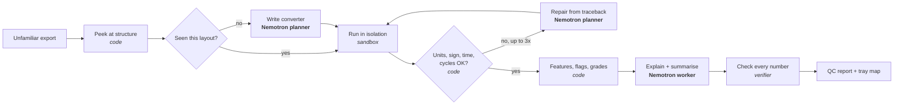

# Vera: the cell QC agent that shows its work

**Drop in a raw Li-ion formation or grading tester export, in any layout. Vera grades every cell, flags the bad
ones with evidence, and writes a QC report in which every number comes from executed code, never from the model.**

Built on **NVIDIA Nemotron** (via the NVIDIA API Catalog or Nebius Token Factory). Live demo (replays recorded runs, no
sign-in): **https://akshit-afk-dot.github.io/vera/**

## The problem

Every new Li-ion cell goes through formation (its first charge and discharge cycles) and grading (capacity and
resistance are measured and the cell is binned for pack matching). One tester runs hundreds of channels at once.
Engineers find the bad cells by opening large exports and checking by hand or with one-off scripts, and three things hurt:

1. **Every tester exports a different layout** (preambles, decimal commas, mV or A, one sheet per tray row, MATLAB
   structs, discharge-positive current), so scripts break on the next file.
2. **Faults are subtle**: capacity a little low, resistance a little high, an odd curve shape, capacity creeping up.
3. **A wrong call costs money both ways**: a weak cell ends up in a pack, or a good cell is scrapped.

## What Vera does



- **Reads any layout without a per-vendor parser.** Nemotron writes a `normalize()` function from a structural peek of
  the file. It runs in an isolated runner with no network and no keys. Deterministic checks reject wrong units,
  inverted current sign, backwards time or missing cycles, and the model repairs its own code from the failure (up to 3 times).
- **Remembers formats.** A validated converter is stored under a layout fingerprint; the next file like it skips the
  model entirely, and the converter is still re-validated.
- **Numbers come from code.** Coulomb-counted capacity, first-cycle coulombic efficiency, a 1-second step resistance,
  capacity trend across cycles, noise, and an offset-aligned Q(V) curve-shape distance. Each is compared with its own
  batch using robust statistics, then graded A / B / C / Reject with editable bins.
- **Explains, and is checked.** Nemotron writes per-flag explanations and the summary; a verifier matches every number
  in that text against the computed results, regenerates a failing sentence once, then drops it, and counts all of it.
- **Shows its work.** The demo replays each run: every model call (model, tokens, latency), every piece of generated
  code, every sandbox result, repair and rejected claim, then the tray heatmap, per-cell curves and the report.

### Why Nemotron, and which one does what

| Role | Model | Calls per run | Why |
|---|---|---|---|
| Planner | largest Nemotron in the provider's catalog | 1–4 | Reading an unfamiliar structure and writing correct pandas is the hard reasoning step |
| Worker | smallest Nemotron in the catalog | about one per fault type + 1 | Short explanations and the summary: fast and cheap |

Model calls scale with the number of **fault types**, not channels: a 128-channel batch costs about the same as an
8-cell one. Raw time series never go to a model. `python -m agent models` prints the models chosen from the live catalog.

## Results

Every table below is generated by `eval/` from fixed seeds or recorded runs; nothing is typed by hand.
Labels: **REAL** = public lab datasets, **SYNTHETIC** = simulated cells with planted faults.

### R1: reads unfamiliar layouts

<!-- R1:start -->
_Filled by `scripts/finish.py` from live runs (needs a model key)._
<!-- R1:end -->

### R2: finds planted faults

<!-- R2:start -->
**R2: planted-fault detection [SYNTHETIC]** · 6 faulty batches (156 planted faults) + 4 clean batches (512 channels) · 128 channels each

| Method | Precision | Recall | F1 | Typed F1 | False alarms on clean batches |
|---|---|---|---|---|---|
| Vera rules (robust z, \|z\|>3.5) | 0.98 | 0.93 | 0.95 | 0.95 | 0.39% |
| Baseline: mean/std z-score (\|z\|>3) | 0.81 | 0.47 | 0.60 | 0.52 | 3.32% |
| Baseline: Isolation Forest (untyped) | 0.48 | 0.41 | 0.44 | untyped | 13.28% |
<!-- R2:end -->

The mildest planted faults (−2% capacity, +10% resistance) sit inside normal cell-to-cell spread: recall 0.74 at that
level, 1.00 above it. Full breakdown and a threshold sweep: [results/r2_detection.md](results/r2_detection.md).
**Caveat:** the rules were developed on the same simulator, so these numbers are optimistic until checked on real
production data.

### R4 and R5: cost, time, self-repair and verification

<!-- R45:start -->
_Filled by `scripts/finish.py` from live runs (needs a model key)._
<!-- R45:end -->

## Run it (five commands)

```bash
git clone https://github.com/Akshit-afk-dot/vera && cd vera
uv sync
cp .env.example .env        # set NVIDIA_API_KEY (free at build.nvidia.com) or NEBIUS_API_KEY
uv run python -m synthetic.generate --channels 128 --seed 7 --out data/synthetic/s7
uv run python -m agent run data/synthetic/s7/export_long.csv --label SYNTHETIC --publish
```

Then open the report in `runs/<id>/report.md`, or serve the demo with
`uv run python -m http.server 8000 --directory web` and visit http://localhost:8000.
Other commands: `uv run pytest -q` (tests), `uv run python -m eval.detection` (R2),
`uv run python scripts/finish.py` (record demo runs and refresh every results table).

**Where code runs.** Model-written code runs in an isolated runner: `SANDBOX_RUNNER=contree` uses Nebius Token Factory
Sandboxes with networking disabled; the default `local` runner is a stripped-environment subprocess for development and
refuses to start on a public deployment. The public demo runs no code at all: it replays recorded runs.

## Limitations

- Public data are lab cells, not production lines; Vera is not validated on a factory tester.
- R2 uses simulated cells from Vera's own simulator. A plausibility model, not electrochemistry.
- Fault rules compare each cell with its own batch; a whole batch that is uniformly bad needs nominal-based bins
  (supported in the Thresholds view).
- The resistance proxy needs a sample within 10 s of a rest-to-discharge step; layouts without one report no resistance.

## Repository

| Path | What |
|---|---|
| `agent/` | Nemotron client, prompts, ingestion checks, sandbox runners, verifier, pipeline, CLI |
| `analysis/` | Deterministic features, rules and grading: the source of every number (also runs in the sandbox) |
| `synthetic/` | Cell simulator, planted faults, four invented export layouts |
| `eval/` | R1 (formats), R2 (detection vs baselines), R4/R5 (from run logs), answer keys |
| `contracts/` | Pydantic models → JSON Schemas for events and results |
| `web/` | Static demo (no build step): replay, tray heatmap, channel curves, report, live regrading |
| `docs/` | Design, decisions, feedback, hackathon notes |

## Data sources and licences

Datasets are never committed; `scripts/fetch_data.py` downloads them and records SHA-256 hashes. Published demo runs
derived from the Oxford dataset are offered under ODbL 1.0. See [THIRD_PARTY.md](THIRD_PARTY.md).

- NASA Prognostics Center of Excellence, Li-ion Battery Aging Datasets.
- Birkl, C. R. *Oxford Battery Degradation Dataset 1*, University of Oxford (ODbL 1.0); Birkl, *Diagnosis and Prognosis
  of Degradation in Lithium-Ion Batteries*, DPhil thesis, University of Oxford, 2017.

## Team and licence

Akshit Kumar and Aryaveer Singh Baloria. Development assisted by Claude Code (Anthropic).
Apache-2.0, see [LICENSE](LICENSE).
